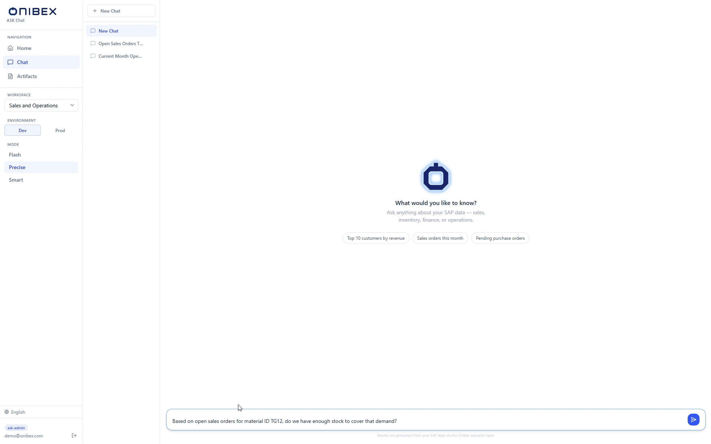
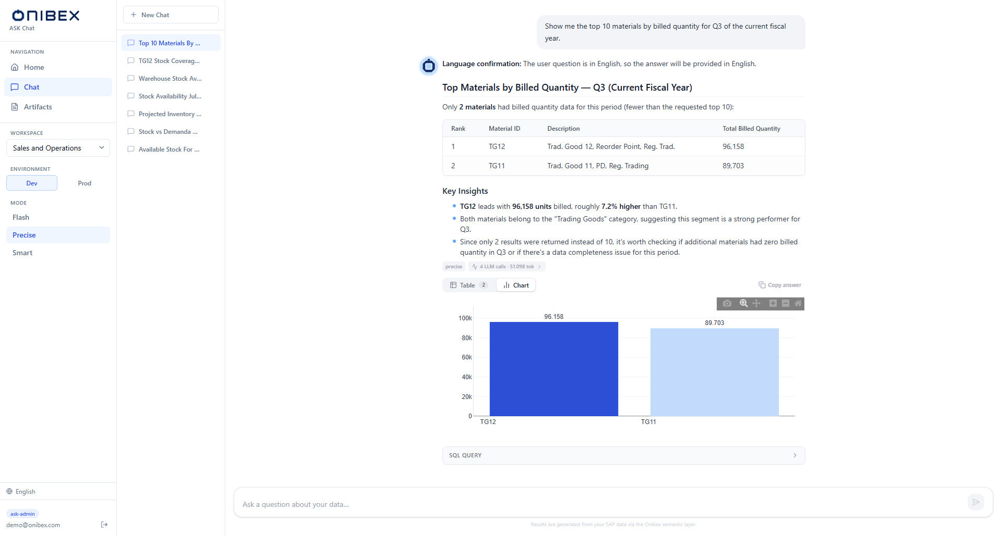
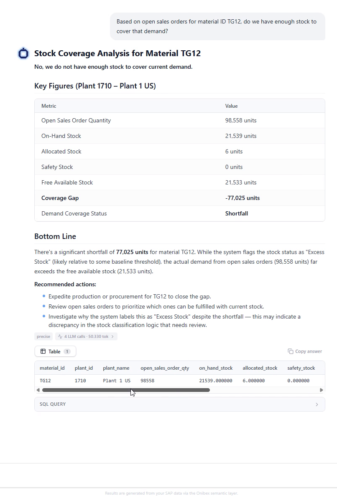
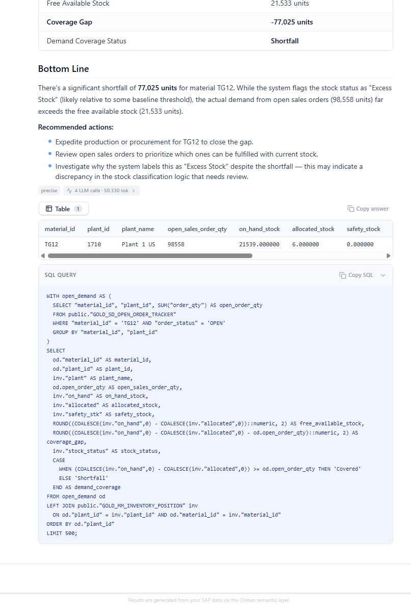
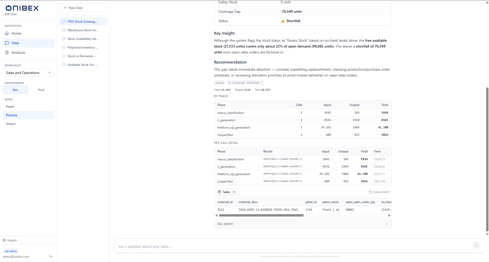
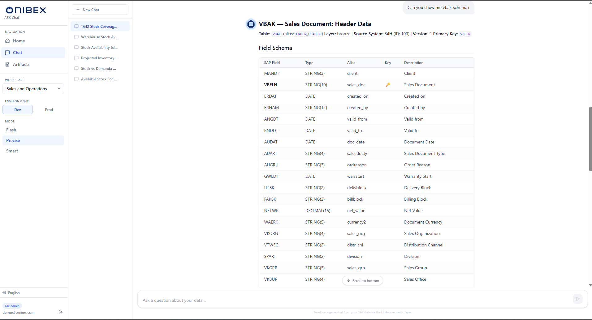
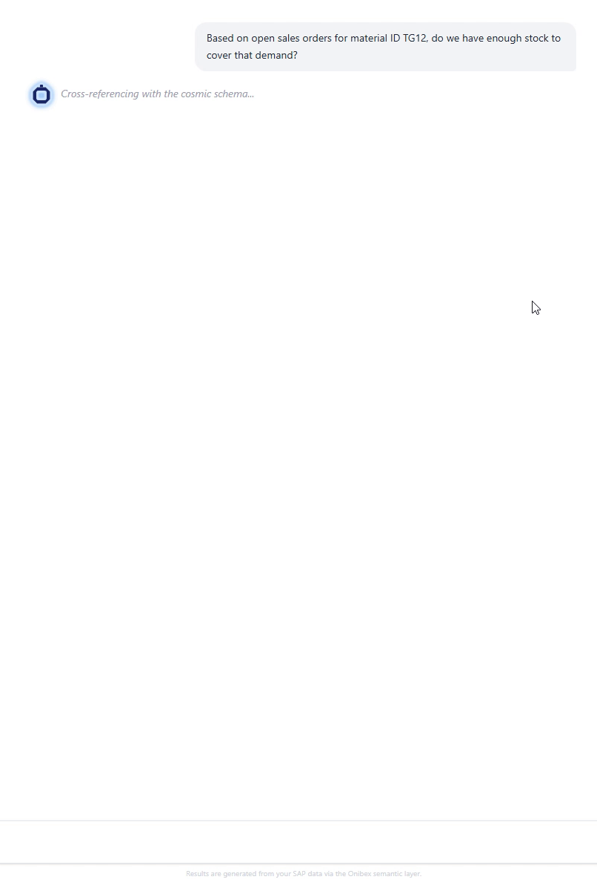

# ASK Chat · Using the Chat

[Manual](../README.md) › [Ask questions](../README.md#ask-questions--ask-chat) › **Using the Chat**

> **How to.** Ask questions in plain language and read governed SQL
> answers: written summaries, results tables, auto-generated charts, and optionally the SQL
> and token trace behind each answer.

| | |
|---|---|
| **Who** | Business user / analyst |
| **Time** | Seconds per question |
| **Prerequisites** | A workspace is selected, an environment chosen, and a mode set (see [Scope a question](01-workspace-environment-mode.md)). |
| **You'll end with** | Answers to your questions: text, tables, charts, in one or more named conversations you can return to. |

---

## What you need to know first

- Each conversation is an independent **chat session** with its own history. You can have
  multiple sessions per workspace and switch between them freely.
- Sessions are **saved to your account** after every answer. You see them from any browser
  or device you sign in on, and no other user sees them. Their messages and results are
  stored encrypted. A session with no questions yet is not saved.
- You type in **natural language**: any language, business terms only. The agent maps your
  words to the governed semantic layer; you never need to know table or column names.
- The agent classifies every question by what answering it needs: **data** (runs SQL),
  **schema** (describes structure) or **action** (writes to SAP via MCP). The type is
  determined by your wording. You don't pick it. A message that asks for nothing, such as a
  greeting, gets a short reply and runs nothing.
- When a data question can be read in more than one way and nothing settles which, the agent
  **asks you once** before answering (see [When the agent asks first](#when-the-agent-asks-first)).
- For data questions, a **chart is drawn automatically** whenever the result has more than
  one row.

---

## 1. Manage sessions

The **Chat history sidebar** sits on the left side of the Chat page, separate from the
main navigation sidebar. It lists all sessions for the currently selected workspace.

| Action | How |
|---|---|
| **New session** | Click **New Chat** at the top of the history sidebar. |
| **Switch session** | Click any session title in the list. |
| **Delete session** | Hover a session and click the trash icon. The session is deleted from your account, in every browser. If deleting leaves no sessions, one is created automatically. |

Session titles start as *"New Chat"* and are automatically renamed by the LLM after the
first exchange, derived from the content of your opening question.

> **Tip:** with every new question the agent reads the last six messages of the session (see
> [Follow up](#4-follow-up)). Use **New Chat** to start a clean thread rather than appending
> unrelated questions to an existing one.

> **Warning:** If no workspace is selected, **New Chat** is disabled and an amber banner
> appears at the top of the page. Select a workspace first (see [Scope a question](01-workspace-environment-mode.md)).

---

## 2. Ask a question

Type your question in the **composer** at the bottom of the chat and press **Enter** (or
click the send button). **Shift + Enter** inserts a line break without sending.

The composer expands automatically as you type (up to a maximum height) and disables while
a response is in progress.

Using the demo's Sales & Distribution model, try:

| What you want | Question to type |
|---|---|
| Data with a chart | `What were the top 10 materials by net sales value last quarter?` |
| Data over time | `Show me total revenue by month for the current year, broken down by sales organization.` |
| Schema | `What tables and fields make up the sales order entity, and how are VBAK and VBAP joined?` |

**Quick-start chips** appear on the empty-state screen before the first message: "Top 10
customers by revenue", "Sales orders this month", and "Pending purchase orders". Clicking
any chip sends it as a message immediately.

---

## 3. Read the answer

### Data questions

For a data question the agent replies with a **written answer** streamed word by word. Once
streaming completes, the full response is rendered with markdown formatting and three tabs
below the text:

**Table tab** (default)

The raw query results in a striped, scrollable table, up to 100 rows displayed. If the
result exceeds 100 rows, a note shows the total count. Columns are auto-detected from the
result set; all values are rendered as strings. A **Copy answer** button copies the written
answer text to the clipboard.

**Chart tab**

Appears only when the result has **at least 2 rows** and at least one numeric column. Click
**Chart** to switch. The chart type is chosen automatically:

| Result shape | Chart type |
|---|---|
| Date or timestamp X axis | Line chart |
| Categorical X, ≤ 8 rows | Vertical bar chart |
| Categorical X, > 8 rows | Horizontal bar chart (sorted ascending) |

Bar charts use a blue gradient scale; line charts use Onibex blue (`#2563eb`). The Y axis
picks the numeric column with the highest maximum value.

**SQL tab**

Collapsed by default. Click **SQL** to expand the raw SQL the agent sent to the database.
A **Copy SQL** button copies it to the clipboard, useful for reuse in an external tool or
for verifying the query logic.

The query above is what the agent actually ran. It joins `GOLD_SD_OPEN_ORDER_TRACKER` to
`GOLD_MM_INVENTORY_POSITION`: two Gold Data Products, resolved from a question that named
neither.

> **Tip:** the mode badge (e.g. *precise*) shown next to the answer tells you which engine
> produced it, in case you switch modes between questions.

**The token badge opens.** Next to the mode badge, `N LLM calls · N tok` expands into the
cost of the answer: by phase, and per call with the model that served it and when.

That panel is why an answer's cost is a fact rather than an estimate. It is also where a slow
answer explains itself: the phase that took the time is named.

### When the agent asks first

Some questions can be read in more than one way, and each reading returns different data.
*"Which plants are confirming less yield than before?"* does not say what "before" is, and
the semantic layer does not define it. When the question, the semantic layer and the earlier
messages of the session all leave that open, the agent asks you one question instead of
guessing, with two to four readings to pick from:

> *Compared with what?*
>
> - a) This month against last month
> - b) This quarter against the same quarter last year
> - c) Confirmed yield against planned quantity, this month

Reply with a letter, with one of the readings, or in your own words. The agent joins your reply
to the original question and answers it, and does not ask again: if something is still open,
the answer says which reading it took. What you settled stays with that question for the rest
of the session (see [Follow up](#4-follow-up)), so a later question that builds on it is not
asked again.

The agent asks only when the open point changes the result. When it changes little, or one
reading is clearly the usual one, the agent answers and says which reading it took. It never
asks about something the question already gives (a period, a filter, a top N) or that the
semantic layer defines.

- Only **Precise** and **Smart** ask. **Flash** answers straight away.
- Only ASK Chat asks. Answers through the agent API (`/external/ask`: watsonx Orchestrate,
  n8n, Zapier, Microsoft Teams) and documents built as artifacts have no one to reply, so they
  take the most reasonable reading and state it.
- An administrator can turn asking off without redeploying (see
  [Orchestrator troubleshooting](../runbooks/orchestrator-troubleshooting.md#6-turn-off-clarifications-in-the-chat)).
  The chat then answers like the agent API.

### Messages the agent runs no query for

- **A message that asks for nothing**, such as a greeting, thanks, or an instruction for later
  (*"remember the database is version 22.1"*), gets a short reply in your language. The agent
  keeps no instructions between questions: put what matters in the question it applies to.
- **A question whose terms the semantic layer does not hold** (Precise) gets a short reply in
  your language saying so: ask again naming the measure and how to break it down, or ask
  whoever maintains the semantic layer to add the term.

### Schema questions

The agent describes the Data Product's structure: tables, fields, their types and roles, and the
exact join predicates, without running a query or drawing a chart.

### Action questions *(requires MCP)*

If the MCP server is configured, the agent extracts the action parameters from your question,
calls the MCP tool on SAP S/4HANA, and confirms whether the write-back succeeded. Action
questions require explicit action-oriented wording ("create", "update", "submit").

---

## 4. Follow up

With every new question the agent reads the last six messages of the session (three questions
and their answers), each answer with the SQL that produced it when that answer came from the
environment you are asking in. A question the agent asked you about and your reply to it count
as one message: the question they complete, with what you settled in it. A follow-up does not
need to repeat what it builds on:

> *"Now break that down by month."*
> *"Run it again for sales organization 1000 only."*
> *"Why does it show 7 materials and not 10?"*

Before any mode sees it, the agent rewrites a follow-up into a complete question: the first two
above become the earlier question with the change applied. This works the same in **Flash**,
**Precise** and **Smart**, and the rewrite appears in the token breakdown as
`followup_rewrite`.

A question about an earlier answer, like the third one, is answered from that answer and its
SQL: the agent explains what the query did and runs nothing new. That reply appears in the token
breakdown as `followup_answer`. To get a different result, ask for the query again with the
change.

Messages older than the last six are not read. To come back to one, ask the full question again.

---

## 5. The thinking indicator

While the backend is processing, a **thinking bubble** appears, a pulsing indicator with
rotating status messages ("Translating your question into SQL…", "Querying the database…",
etc.). The indicator disappears as soon as streaming begins.

---

## 6. Scroll behaviour

The chat auto-scrolls to new content while you are near the bottom of the thread. If you
scroll up to review earlier messages, auto-scroll pauses. A floating **↓ Scroll to bottom**
button appears when you are more than 100 px above the latest message, click it to jump
back down and re-enable auto-scroll.

---

## What's next

→ **[Generate a report or brief](03-artifacts.md)**: turn your data into shareable reports, executive
briefs, and data tables.
→ **[Scope a question](01-workspace-environment-mode.md)**, change the
workspace or switch to the `prod` environment.

---

[← Back to the manual](../README.md)
